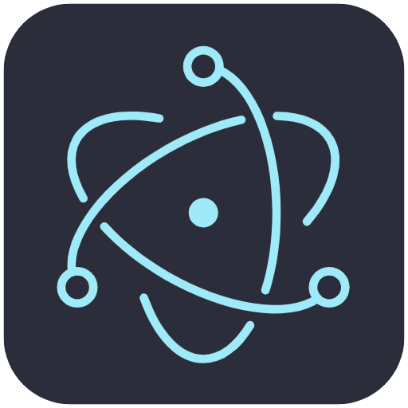

<div align="center">
  

  <h1>OpenPen Anno</h1>

  <p><strong>Draw on any Windows app. Then click straight through your ink.</strong></p>

[](https://github.com/raghavdixit-2006/OpenPen-Anno/releases/latest)
[](https://github.com/raghavdixit-2006/OpenPen-Anno/releases)
[](https://github.com/raghavdixit-2006/OpenPen-Anno/releases/latest)
</div>


OpenPen Anno is a transparent, always-on-top annotation layer for Windows. Draw
over a browser, a document, a spreadsheet, or a call — then switch to
**passthrough** and the ink stays visible while every click reaches the app
underneath.

## Download

**→ [Download the latest installer](https://github.com/raghavdixit-2006/OpenPen-Anno/releases/latest)**

Windows 10 (1903+) and Windows 11 · 64-bit · ~120 MB

The installer is not code-signed yet, so SmartScreen may warn on first run:
choose **More info → Run anyway**.

## Features

- **Ten tools** — pen, highlighter, eraser (stroke or pixel), text, numbered
  stamps, laser pointer, line, arrow, rectangle, ellipse.
- **Ink that stays** — annotations remain on screen in passthrough without
  blocking clicks.
- **Freeze frame** — snapshot the screen, then annotate the still with 1–4×
  zoom and pan.
- **Backdrops** — whiteboard, blackboard, or a spotlight around the cursor.
- **Annotated screenshots** — save the live screen plus your ink as a PNG.
- **Multi-monitor** — follow the cursor or pin the overlay to one display.
- **Out of the way** — dock the toolbar to any edge, or collapse it into a hover
  tab.
- **Keyboard-first** — global hotkeys, with Ctrl+Z captured only while drawing.
- **Automatic updates** — installed builds update from GitHub.


## Getting started

1. Install and launch. The toolbar docks to the bottom edge and the app starts
   in passthrough.
2. Press **Ctrl+Shift+D** or click the toolbar toggle to start drawing.
3. Draw. Press it again to hand clicks back to the app underneath.
4. **Ctrl+Shift+C** clears everything; **Ctrl+Z / Ctrl+Y** undo and redo while
   drawing.

| Shortcut            | Action                          |
| ------------------- | ------------------------------- |
| `Ctrl+Shift+D`      | Toggle drawing / passthrough    |
| `Ctrl+Shift+F`      | Toggle freeze frame             |
| `Ctrl+Shift+C`      | Clear all ink                   |
| `Ctrl+Z` / `Ctrl+Y` | Undo / redo (drawing mode only) |
| `Ctrl+Shift+Q`      | Quit                            |

## Tray menu

Right-click the tray icon for drawing mode, backdrop, freeze frame, display,
collapse, clear, **Save annotated screenshot…**, hardware acceleration, update
checks, and quit.

## Settings

Preferences live in `%APPDATA%\openpen-anno\settings.json`: tool, colour, brush
size, eraser mode, backdrop, dock side, collapsed state, and hardware
acceleration. Drawing mode is never persisted — the app always starts in
passthrough so a restart cannot leave the overlay swallowing clicks.

## Build from source

Requires Node.js 22+ and pnpm.

```bash
pnpm install
pnpm dev          # development with HMR
pnpm test         # engine unit tests
pnpm typecheck
pnpm build:win    # NSIS installer in dist/
```

```
src/main/       Electron main: windows, hotkeys, tray, IPC
src/preload/    sandboxed contextBridge API
src/renderer/   overlay canvas, toolbar, popover, text editor
src/engine/     framework-free stroke model, renderer, history
src/shared/     IPC channels and shared types
```

Logs: `%APPDATA%\openpen-anno\logs\main.log`.
